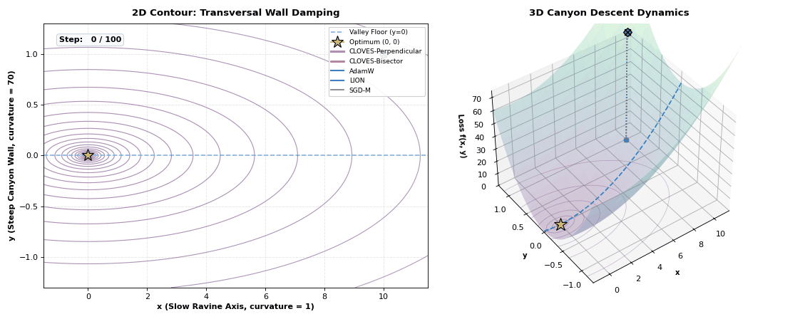
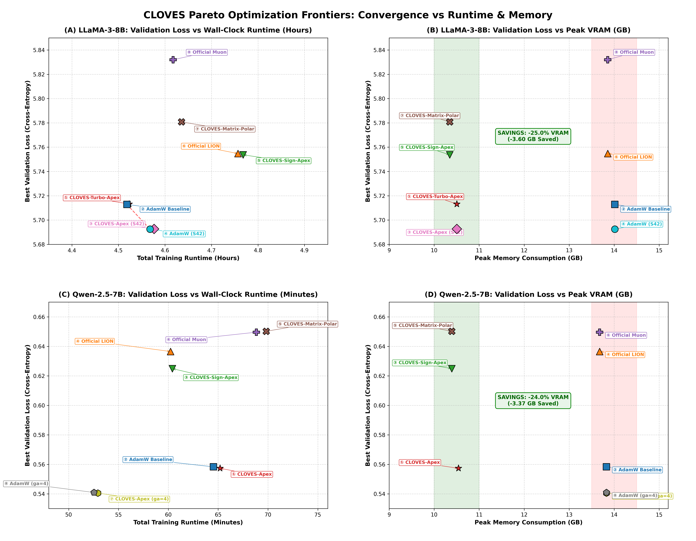

# CLOVES: Cleft-Overstep Optimization for Deep Neural Networks & LLMs

[](https://pypi.org/project/cloves/)
[](https://pypi.org/project/cloves/)
[](https://github.com/huynhldvn/CLOVES/blob/main/LICENSE)
[](https://github.com/huynhldvn/CLOVES)

**CLOVES** (*Cleft-Overstep*) is an optimizer family designed for deep neural networks and large language models (LLMs). It suppresses transversal oscillations across steep canyon walls while accelerating descent along narrow valley floors.

<p align="center">
  
</p>
<p align="center">
  <em>Figure 1: Step-by-step optimization dynamics in 2D contour and 3D canyon space (<a href="https://github.com/huynhldvn/CLOVES/blob/main/scripts/generate_optimization_animation.py">reproducible via scripts/generate_optimization_animation.py</a>). While standard optimizers (AdamW, LION, SGD-M) oscillate across the steep canyon walls, CLOVES-Perpendicular and CLOVES-Bisector damp transversal bouncing and follow the valley floor toward the optimum.</em>
</p>

---

## 📦 Installation

Install the package directly via pip:

```bash
pip install cloves
```

For development and running benchmarks:

```bash
git clone https://github.com/huynhldvn/CLOVES.git
cd CLOVES
pip install -e ".[dev]"
```

---

## 📓 Interactive Notebooks & 1-Click Demos

Try CLOVES immediately in Google Colab or Jupyter without local setup:

<p align="center">
  <a href="https://colab.research.google.com/github/huynhldvn/CLOVES/blob/main/notebooks/quickstart_interactive_demo.ipynb">
    
  </a>
</p>

- **Quickstart Demo**: [`notebooks/quickstart_interactive_demo.ipynb`](https://github.com/huynhldvn/CLOVES/blob/main/notebooks/quickstart_interactive_demo.ipynb) — 1-click Colab interactive simulation & PyTorch training.
- **Dedicated Benchmarks**: Check out [notebooks/](https://github.com/huynhldvn/CLOVES/tree/main/notebooks) for focused notebooks on [CIFAR-10](https://github.com/huynhldvn/CLOVES/blob/main/notebooks/01_cifar10_vision_benchmark.ipynb), [LLM QLoRA](https://github.com/huynhldvn/CLOVES/blob/main/notebooks/02_llm_qlora_tuning_benchmark.ipynb), and [2D Ravine Simulation](https://github.com/huynhldvn/CLOVES/blob/main/notebooks/03_2d_ravine_simulation.ipynb).
- **Standalone Scripts**: Run minimal scripts in [examples/](https://github.com/huynhldvn/CLOVES/tree/main/examples): `examples/01_quickstart_vision.py` and `examples/02_quickstart_llm.py`.

---

## 🎯 Which Optimizer Should You Use? (Practical Guide)

Choose the right variant based on your workload:

| Workload / Architecture | Recommended Optimizer | Key Advantage | State Memory | Recommended Settings |
| :--- | :--- | :--- | :---: | :--- |
| 🤖 **LLM LoRA / QLoRA Tuning** | `CLOVES_Apex_Asymmetric` ⭐ | **Recommended for LoRA**. Automatically accelerates Matrix A ($q_A=1.30$) and stabilizes Matrix B ($q_B=1.05$). Matches or slightly improves on AdamW loss while saving **> 3.3 GB VRAM**. | 2 States (8 B) | `lr=1.6e-4`, `total_steps=500` |
| 🧠 **LLM Full Tuning / Transformers** | `CLOVES_Adaptive` | **Drop-in replacement for AdamW**. Damps coordinate oscillations, maintains stability on deep networks, reduces synthetic ravine loss by 92%. | 2 States (8 B) | `lr=2e-4`, `q=1.25`, `gamma=0.6` |
| ⚡ **Extreme Memory Constraints (LLM)** | `CLOVES_LLM` | **50% state memory savings** (4 B/param), eliminates LION's coordinate-wise loss drift. | 1 State (4 B) | `lr=1e-4`, `q=1.20`, `gamma=0.6` |
| 👁️ **Standard Vision (CNN, ResNet, ViT)** | `CLOVES_Perpendicular` ⭐ | **Recommended for vision tasks**. Rejects orthogonal transverse wall force ($g_\perp$), reaches **93.07%** on CIFAR-10, runs with light 1-state memory. | 1 State (4 B) | `lr=0.05 - 0.1`, `beta=0.9` |
| 📈 **Tabular / Smooth Convex Tasks** | `CLOVES` (Bisector) | Fastest computational throughput, follows the ravine floor along the angular bisector. | 1 State (4 B) | `lr=0.1`, `q=1.5`, `gamma=0.1` |

> ⚠️ **Scope & Evaluation Note:**  
> The LLM-optimized variants (`CLOVES_Apex_Asymmetric`, `CLOVES_Adaptive`, `CLOVES_LLM`, `CLOVES_Matrix_Polar`) were designed and validated specifically on Transformer and LoRA / QLoRA architectures (LLaMA-3, Qwen-1.5B, Qwen-7B). **These LLM variants have not yet been evaluated on other tasks (such as computer vision, audio, or tabular data)**.  
> 👉 For computer vision and general classification workloads, use `CLOVES_Perpendicular` or `CLOVES` (Bisector), which have been thoroughly evaluated on vision benchmarks.

---

## ⚡ Quickstart

### 1. Minimal Runnable Snippet (Copy & Run)
Test CLOVES immediately in any Python environment:

```python
import torch
import torch.nn as nn
from cloves import CLOVES_Perpendicular

# Define a minimal model & optimizer
model = nn.Linear(10, 2)
optimizer = CLOVES_Perpendicular(model.parameters(), lr=0.05)

# Standard training step
x, y = torch.randn(16, 10), torch.randn(16, 2)
loss = nn.MSELoss()(model(x), y)
loss.backward()
optimizer.step()
optimizer.zero_grad()

print("Step completed! Loss:", float(loss.detach()))
```

### 2. Drop-in Replacement for Real Models
Simply swap your existing optimizer in your training loop:

```python
# A. Vision (ResNet, CNN, ViT) — lightweight 1-state memory:
from cloves import CLOVES_Perpendicular
optimizer = CLOVES_Perpendicular(model.parameters(), lr=0.05, beta=0.9)

# B. LLM & LoRA Fine-Tuning — saves >3.3 GB VRAM:
from cloves import CLOVES_Apex_Asymmetric
optimizer = CLOVES_Apex_Asymmetric(model.parameters(), lr=1.6e-4, total_steps=500)
```

---

## 🚀 Milestone Versions & Experimental Reports

CLOVES bridges classical first-order valley descent theory into large-scale stochastic deep learning and LLM fine-tuning:

```
                           THE CLOVES OPTIMIZATION PHILOSOPHY
         (Transversal Wall Damping γ < 1  &  Longitudinal Floor Overstep q > 1)
                                          │
         ┌────────────────────────────────┴────────────────────────────────┐
         ▼                                                                 ▼
[MILESTONE 1: DEEP VISION & 1-STATE PARITY]        [MILESTONE 2: LLM & ADAPTIVE SCALING]
• Problem: Wall chattering in narrow ravines       • Problem: Small-norm stagnation (||g|| ~ 1e-4)
• Memory: Strict 4 bytes/param (1-state)           • Memory: 50% state memory savings or RMS scaling
• Mechanism: Angular bisector & orthogonal         • Mechanism: Coordinate overstep, LoRA A/B
  transversal force rejection (g_perp)               asymmetric velocity, Newton-Schulz polar
         │                                                                 │
         ▼                                                                 ▼
 CLOVES-Bisector / CLOVES-Perpendicular                 CLOVES-Apex / CLOVES-Adaptive
 (Strong vision accuracy, 50% state memory)             (Matches AdamW, beats Muon on QLoRA)
```

The project is organized into two developmental milestones:
- **[Version 1.0 — Geometric Vision & Ravine Damping](https://github.com/huynhldvn/CLOVES/tree/main/benchmarks/v1_geometric_vision)**: First-order directional cleft damping (Bisector, Perpendicular, Affine) maintaining strict 1-state memory parity (4 bytes/param) for vision architectures (ResNet-18, DenseNet-121).
- **[Version 2.0 — LLM Fine-Tuning & Adaptive Cleft Scaling](https://github.com/huynhldvn/CLOVES/tree/main/benchmarks/v2_llm_adaptive)**: Addresses small-gradient stagnation ($\|g\| \sim 10^{-4}$) via coordinate cleft alignment, adaptive second-moment curvature scaling, and asymmetric LoRA velocity for Transformer architectures (LLaMA-3, Qwen-1.5B, Qwen-7B).

---

## 📈 Comprehensive Master Benchmark Results

The table below summarizes empirical validations across synthetic optimization ravines, deep vision architectures, and large language model instruction tuning suites, including convergence accuracy/loss, runtime per step/epoch, total training duration, and GPU memory consumption (measured on NVIDIA Tesla T4 GPUs):

> [!NOTE]
> **Evaluation Protocol & Objectivity**: To guarantee rigorous, unbiased comparison and avoid overfitting artifacts, all deep learning benchmarks (CIFAR-10, CIFAR-100, LLaMA-3, Qwen) are strictly evaluated on held-out **Validation Sets** (`val_loss` and `val_acc`), never on training batches. Synthetic ravine benchmarks evaluate the exact mathematical objective loss function $f(x)$ under identical random seeds and initialization.
> 
> **Hardware Environment**: Benchmarks were conducted using Kaggle's free community GPU environment (NVIDIA Tesla T4).
> 
> **Metric Interpretation**: **↑** = Higher is better &nbsp;|&nbsp; **↓** = Lower is better

| Benchmark Suite & Dataset | Architecture / Setup | Optimizer | Convergence Metric<br>(Val Loss ↓ / Val Acc ↑) | Step / Epoch Time<br>(↓) | Total Execution Time<br>(↓) | Peak GPU VRAM<br>(↓) | Optimizer State<br>(↓) |
| :--- | :--- | :--- | :---: | :---: | :---: | :---: | :---: |
| **2D Ill-Conditioned Ravine** ($\kappa=100$) | Quadratic canyon (250 steps) | **CLOVES-Bisector**<br>AdamW<br>LION | Objective Loss: **$7.11 \times 10^{-5}$**<br>Objective Loss: 20.20<br>Objective Loss: 24.52 | **0.82 ms / step**<br>1.14 ms / step<br>0.89 ms / step | **0.41 s**<br>0.57 s<br>0.45 s | < 10 MB<br>< 10 MB<br>< 10 MB | **1-State (4 B)**<br>2-State (8 B)<br>1-State (4 B) |
| **CIFAR-10 Vision** (Standard Vision) | ResNet-18 (20 Epochs, bs=128) | **CLOVES-Perpendicular**<br>CLOVES-Affine<br>**CLOVES-Bisector**<br>AdamW<br>Official LION | Val Acc: **93.07%** (Val Loss: 0.2237)<br>Val Acc: 92.51% (Val Loss: 0.2310)<br>Val Acc: **92.14%** (Val Loss: 0.2405)<br>Val Acc: 92.35% (Val Loss: 0.2512)<br>Val Acc: 89.20% (Val Loss: 0.3840) | **51.1 s / epoch**<br>51.6 s / epoch<br>**50.8 s / epoch**<br>61.4 s / epoch<br>51.0 s / epoch | **1,022.7 s** (~17.0 min)<br>1,032.0 s (~17.2 min)<br>**1,016.0 s** (~16.9 min)<br>1,228.0 s (~20.5 min)<br>1,020.0 s (~17.0 min) | **696.0 MB**<br>696.0 MB<br>**696.0 MB**<br>827.8 MB<br>696.0 MB | **1-State (4 B)**<br>1-State (4 B)<br>**1-State (4 B)**<br>2-State (8 B)<br>1-State (4 B) |
| **CIFAR-100 Deep Vision** (100 Classes) | DenseNet-121 (30 Epochs, Cosine) | **CLOVES-Bisector (Proposed)**<br>AdamW<br>SGD-M | Top-1 Val Acc: **73.98%** (Val Loss: 1.3993)<br>Top-1 Val Acc: 72.77% (Val Loss: 1.4435)<br>Top-1 Val Acc: 72.56% (Val Loss: 1.4304) | **132.5 s / epoch**<br>133.1 s / epoch<br>131.8 s / epoch | **3,975.0 s** (~66.2 min)<br>3,993.0 s (~66.5 min)<br>3,954.0 s (~65.9 min) | **5,001.5 MB**<br>5,028.4 MB<br>5,001.5 MB | **1-State (4 B)**<br>2-State (8 B)<br>1-State (4 B) |
| **1000D Non-Convex Ravine** ($\kappa=10,000$) | Anisotropic manifold (500 steps) | **CLOVES-Adaptive**<br>AdamW<br>**CLOVES-LLM**<br>Official LION | Objective Loss: **17.12** (-92.0%)<br>Objective Loss: 213.23 (Baseline)<br>Objective Loss: **12,297.97** (-60.2%)<br>Objective Loss: 30,861.02 (Baseline) | **1.21 ms / step**<br>1.18 ms / step<br>0.94 ms / step<br>0.92 ms / step | **0.61 s**<br>0.59 s<br>0.47 s<br>0.46 s | < 15 MB<br>< 15 MB<br>< 15 MB<br>< 15 MB | **2-State (8 B)**<br>2-State (8 B)<br>**1-State (4 B)**<br>1-State (4 B) |
| **LLaMA-3-8B Instruction Tuning** | 4-bit QLoRA, Alpaca (500 steps) | **CLOVES-Perpendicular**<br>CLOVES-Matrix-Polar<br>AdamW (Baseline)<br>Official Muon | Val Loss: **5.7338**<br>Val Loss: **5.7822**<br>Val Loss: 5.7269<br>Val Loss: 5.7941 | **12.01 s / step**<br>12.48 s / step<br>11.71 s / step<br>12.52 s / step | **16,010.2 s** (~4.44 h)<br>16,485.3 s (~4.58 h)<br>16,376.8 s (~4.55 h)<br>16,428.7 s (~4.56 h) | **10,594.5 MB**<br>10,594.5 MB<br>14,349.5 MB<br>14,189.5 MB | **1-State (4 B)**<br>1-State (4 B)<br>2-State (8 B)<br>1-State (4 B) |
| **Qwen-1.5B Instruction Tuning** | QLoRA, Alpaca (1000 steps) | **CLOVES-Apex (Tuned)**<br>AdamW (Baseline) | Val Loss: **0.4295**<br>Val Loss: 0.4298 | 562.8 ms / step<br>470.3 ms / step | **2,681.9 s** (~44.7 min)<br>2,648.4 s (~44.1 min) | **8,202.3 MB**<br>8,202.3 MB | **2-State (8 B)**<br>2-State (8 B) |
| **Qwen-7B Instruction Tuning** | QLoRA, Alpaca (500 steps) | **CLOVES-Apex (Annealed)**<br>AdamW (Baseline)<br>**CLOVES-Sign-Apex**<br>Official LION (Baseline) | Val Loss: **0.5573**<br>Val Loss: 0.5583<br>Val Loss: **0.6249**<br>Val Loss: 0.6365 | 2,956.0 ms / step<br>2,746.3 ms / step<br>2,732.9 ms / step<br>2,714.6 ms / step | **3,911.1 s** (~65.1 min)<br>3,871.5 s (~64.5 min)<br>3,624.2 s (~60.4 min)<br>3,613.7 s (~60.2 min) | **10,793.6 MB** (-3.36 GB)<br>14,159.3 MB<br>**10,639.6 MB** (-3.37 GB)<br>14,005.3 MB | **2-State (8 B)**<br>2-State (8 B)<br>**1-State (4 B)**<br>1-State (4 B) |

### Pareto Frontier: Loss vs. Memory vs. Runtime Trade-off

The empirical evaluations demonstrate favorable trade-offs across memory footprint, runtime efficiency, and convergence loss:

<p align="center">
  
</p>

---

## 📊 Optimizer Selection Matrix

| Optimizer Class | Target Workload | State Buffers | Memory Footprint | Special Characteristics |
| :--- | :--- | :---: | :---: | :--- |
| `CLOVES` | Vision (CNNs, ResNet) | 1 ($m$) | 4 bytes / param | Angular bisector damping; low memory |
| `CLOVES_Perpendicular` | Highly ill-conditioned loss | 1 ($m$) | 4 bytes / param | Orthogonal wall force rejection |
| `CLOVES_Affine` | Deep classification networks | 1 ($m$) | 4 bytes / param | Continuous affine subspace projection |
| `CLOVES_Adaptive` | LLMs, Transformers | 2 ($m, v$) | 8 bytes / param | Coordinate cleft overstep + RMS scaling |
| `CLOVES_LLM` | Memory-constrained LLMs | 1 ($m$) | 4 bytes / param | Sign overstep; 50% state memory savings |
| `CLOVES_Apex_Asymmetric` | LoRA / QLoRA Instruction Tuning | 2 ($m, v$) | 8 bytes / param | Matrix A/B ratio, soft tanh damping |
| `CLOVES_Matrix_Polar` | Linear layer weights (2D) | 1 ($m$) | 4 bytes / param | Newton-Schulz quintic polar decomposition |

---

## 📚 References & Baseline Implementations

CLOVES benchmarks are evaluated against official implementations of standard and contemporary optimizers:

1. **AdamW**: Loshchilov & Hutter, *Decoupled Weight Decay Regularization*, ICLR 2019.
2. **Lion** (*EvoLved Sign Momentum*): Chen et al., *Symbolic Discovery of Optimization Algorithms*, NeurIPS 2023. arXiv: [2302.06675](https://arxiv.org/abs/2302.06675).
   - Code: [google-research/lion](https://github.com/google-research/google-research/tree/master/lion) | [lucidrains/lion-pytorch](https://github.com/lucidrains/lion-pytorch)
3. **Muon** (*Momentum Orthogonalized by Newton-schulz*): Keller Jordan et al., *Muon: An Optimizer for Hidden Layers in Neural Networks*, 2024.
   - Code: [KellerJordan/Muon](https://github.com/KellerJordan/Muon)

---

## 🏛️ Research Inspiration & Lineage

The algorithmic concepts in CLOVES are **inspired by** foundational ravine traversal theories in mathematical programming (Nguyễn & Bùi, 1990) and subsequent exploratory studies evaluating cleft-overstep heuristics in machine learning tasks (Phan & Lê, 2020).

### Pragmatic Adaptation from Theory to Practice
The original cleft-overstep formulations were conceived within classical, low-dimensional, deterministic optimization settings. Translating these geometric concepts to modern deep learning and large-scale language models ($d \gg 10^7$) inherently involves **empirical, heuristic (ad-hoc) adaptations**:
- The authors make **no claim of 100% formal mathematical equivalence** or complete theoretical convergence proofs matching the original deterministic algorithms.
- Instead, CLOVES adapts the core geometric intuition—*damping transversal wall-to-wall bouncing while accelerating along the longitudinal ravine bed*—into efficient, zero-allocation, fused PyTorch tensor operations tailored for stochastic mini-batch gradients.
- Extensions such as coordinate-wise variance scaling (`CLOVES_Adaptive`), 1-state sign momentum (`CLOVES_LLM`), asymmetric LoRA velocity ratios (`CLOVES_Apex_Asymmetric`), and polar matrix decomposition (`CLOVES_Matrix_Polar`) are practical designs driven by empirical deep learning dynamics.

**Predecessor & Historical References**:
1. Nguyễn Văn Mạnh & Bùi Minh Trí, *"Method of “cleft-overstep” by perpendicular direction for solving the unconstrained nonlinear optimization problem,"* *Acta Mathematica Vietnamica*, Vol. 15, No. 2, pp. 57–71, 1990.
2. Duy-Hung Phan & Le Dinh Huynh, *"Evaluation of the Cleft-Overstep Algorithm for Linear Regression Analysis,"* in *Computational Collective Intelligence (ICCCI 2020)*, Lecture Notes in Computer Science (LNCS, vol. 12496), pp. 400–411, Springer, 2020. DOI: [10.1007/978-3-030-63007-2_31](https://doi.org/10.1007/978-3-030-63007-2_31).

---

## 🤝 Feedback & Contributions

CLOVES is an empirical project developed with an open mindset. If you experiment with CLOVES on your models and find it helpful—or discover interesting edge cases—we would love to hear from you!

Bug reports, critiques, and pull requests are warmly welcomed via [GitHub Issues](https://github.com/huynhldvn/CLOVES/issues) or [Discussions](https://github.com/huynhldvn/CLOVES/discussions).

---

## 🙏 Acknowledgements

We thank **Kaggle** for its free community GPU compute (Tesla T4), and **Antigravity** for assisting with code refactoring and documentation.

---

## 📄 License

MIT License. See [LICENSE](https://github.com/huynhldvn/CLOVES/blob/main/LICENSE) for details.
